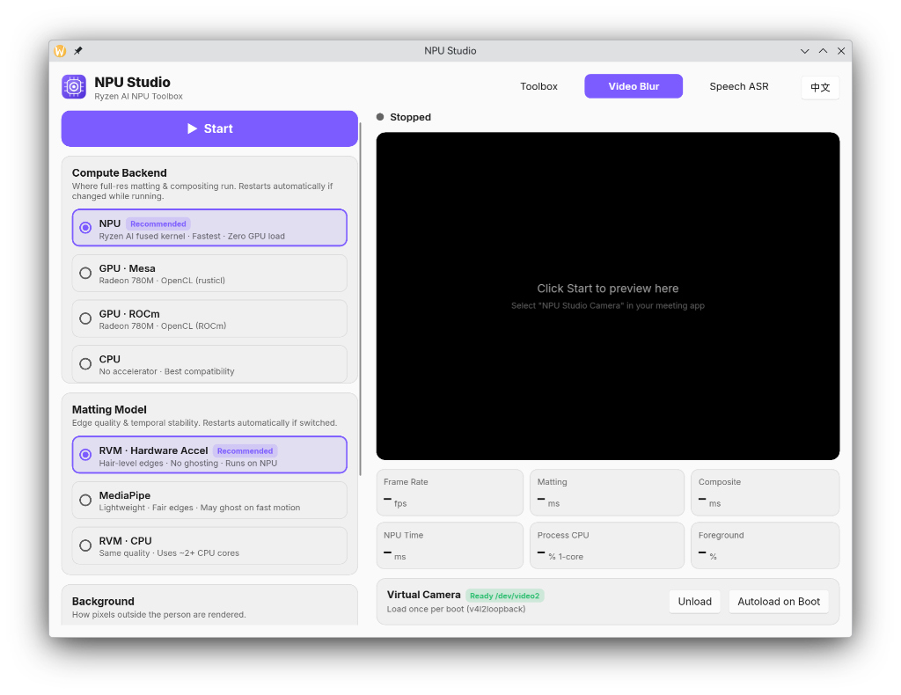
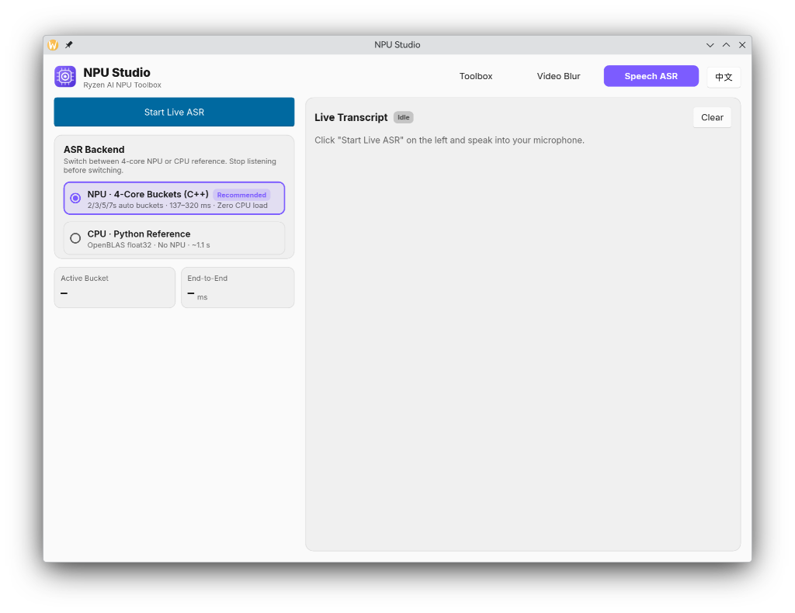

# NPU Studio — Experimental Ryzen AI (7840HS / XDNA1) Desktop Toolbox

**English** | [简体中文](README.zh-CN.md)

> **Experimental Project Notice**: This repository is a personal experimental playground exploring what AMD's first-generation Ryzen AI NPU can actually do on Linux. The implemented tools work in day-to-day use, but rough edges, hardware-specific quirks, and sharp corners are expected — there is no guarantee of perfection.

---

## Why This Exists

The **AMD Ryzen 7 7840HS** ("Phoenix") shipped with AMD's first-generation **XDNA1 (AIE2)** NPU (~10 TOPS). As AMD quickly moved on to Hawk Point and Strix Point (XDNA2), this early Phoenix NPU received minimal ecosystem support. On Windows, it at least powered basic *Windows Studio Effects* (background blur, etc.); on Linux — even after the `amdxdna` driver was upstreamed into the Linux `accel` subsystem (around kernel 6.14+) — almost no consumer desktop software used it. Many Linux users joked that it was just an idle "silicon heater" (`电阻丝`) and disabled it in BIOS.

With AI-assisted kernel and compiler engineering (`mlir-aie` / IRON + XRT + `amdxdna`), this project explores a simple question: **can this early XDNA1 NPU actually run practical real-time workloads on Linux and offload CPU/GPU?**

It turns out it can — here are three working end-to-end tools built directly on custom AIE2 C++ tile kernels (`aie::mmul<4,8,8>`, asymmetric-stride DWConv, fixed-point LayerNorm, LUT GELU, Attention) and a Rust + Slint desktop UI.

---

## Implemented Modules

| Video Blur & Virtual Camera | Live Speech Recognition (ASR) |
|---|---|
|  |  |

### 1. Background Blur & Virtual Camera (`studio/` + `npu/rvm/`)
- Real-time portrait segmentation (**RVM MobileNetV3 int8** or **MediaPipe**) + background blur / custom image / green screen.
- Outputs to `v4l2loopback` (`NPU Studio Camera`) for Zoom, OBS, and browsers (tested with Flatpak Zoom; supports one-click **Load / Unload / Autoload** in the UI).
- Switchable compute backends: **NPU**, **GPU (Mesa rusticl / ROCm OpenCL on Radeon 780M)**, or **CPU**.

### 2. Real-time 40-Layer Transformer Speech Recognition (`npu/asr/`)
- Full 40-layer quantized int8 Transformer acoustic model running on 4-core NPU (`max_diff == 0` bit-exact against numpy integer reference, `CER 0%` on test samples).
- Standalone **C++ XRT + OpenBLAS** streaming daemon (`npu/asr/asr_npu.cpp`) with zero Python runtime overhead:
  - **Cold start**: `0.67–0.95 s`
  - **Auto 4-bucket sizing (2s / 3s / 5s / 7s)**:
    - `W=10` (≤2s): **`136.7 ms`** end-to-end (`fb=0.7 / fe=4.1 / npu=130.2 / out=1.7 ms`)
    - `W=15` (≤3s): **`159.5 ms`** end-to-end
    - `W=25` (≤5s): **`219.4 ms`** end-to-end
    - `W=35` (≤7s): **`320.0 ms`** end-to-end
- Also includes a CPU reference backend (`OpenBLAS float32`) in the GUI for direct comparison.

### 3. Screen Snip OCR (`npu/ocr/` + `app/src/ocr.rs`)
- Heterogeneous **PP-OCRv4 Mobile** Chinese + English OCR:
  - **NPU (int8)**: 49-layer MobileNetV3 detection backbone (`~35 ms` per `480×640` tile) + 50-layer PP-LCNet recognition backbone (`max_diff == 0`, `~20 ms` per text line, using asymmetric `s=(2,1)/(1,2)` DWConv).
  - **CPU (`onnxruntime`)**: FPN + DBHead (`~13 ms`) and SVTR + 6625-class CTC head (`~1–3 ms`/line).
- **1:1 Tiled Inference**: Overlapping `480×640` detection tiles + whitespace-gap line splitting (`48×320` chunks) so `1000+ px` wide screenshots and small UI fonts stay sharp.
- Integrated region-snip capture (`spectacle -r` on KDE Wayland, with `grim+slurp` / `gnome-screenshot` fallbacks), thumbnail preview, editable output, and one-click clipboard copy.

### 4. NPU Studio Desktop Toolbox (`app/`)
- Built with **Rust + Slint 1.18**.
- Modular **Toolbox** navigation: *Toolbox Overview*, *Background Blur*, *Live Speech Recognition (ASR)*, and *Screen OCR*.
- Built-in **English / 中文** language switch (persisted in `~/.config/npu-studio/settings.json`).

---

## Tested Environment & Dependency Versions

All results and builds in this repository were verified on the following stack:

| Component | Tested Version | Notes |
|---|---|---|
| **APU / NPU** | AMD Ryzen 7 7840HS (Phoenix) | 1st-gen XDNA1 AIE2 NPU (~10 TOPS) + Radeon 780M |
| **Linux Kernel** | `7.4.0-rc2-1-cachyos-rc` | With `amdxdna` kernel driver |
| **XRT** | `1:2.21.75-14` | Xilinx Runtime (keep matched with `xrt-plugin-amdxdna` via `IgnorePkg = xrt` on Arch/CachyOS if repo `xrt` is ahead) |
| **XRT XDNA Plugin** | `1:2.21.75-2.1` | `xrt-plugin-amdxdna` |
| **MLIR-AIE (IRON)** | `1.3.4` | Python AIE2 compiler/runtime |
| **Python** | `3.14.10` | With `numpy 2.5.4`, `opencv-python-headless 5.0.0.93` |
| **BLAS** | `OpenBLAS` (`libopenblasp` / `cblas 3.12.1`) | Required for fast C++ ASR frontend & `out_w` |
| **Virtual Camera** | `v4l2loopback-dkms 0.15.4-2` | Loaded with `exclusive_caps=1` |
| **Desktop GUI** | `rustc 1.99.1`, `slint 1.18` | Compiled with `cargo build --release` |

---

## Build & Installation

### 1. Verify NPU Kernels
```bash
source npu/env.sh
.venv-iron/bin/python -m npu.check --quick   # Expect 20/20 passing (max_diff == 0)
```

### 2. Build the C++ 4-Bucket ASR Backend
```bash
source npu/env.sh
.venv-iron/bin/python -m npu.asr.export_c_bundle   # Exports to ~/.npu/asr/asr_4c_bundle

L=$PWD/.venv-iron/lib/python3.14/site-packages/opencv_python_headless.libs
g++ -O3 -std=c++17 -I/usr/include/xrt npu/asr/asr_npu.cpp -lxrt_coreutil \
    $L/libopenblasp-r0-59ffcd50.3.15.so -Wl,-rpath,$L -lm -o ~/.npu/asr/asr_npu_cpp
```

(Optional) Test microphone input in terminal:
```bash
.venv-iron/bin/python -m npu.asr.shell_asr --cpp
```

### 3. Build & Install NPU Studio GUI
```bash
./app/install.sh
```
This builds the release binary (`app/target/release/npu-studio`) and installs the desktop entry to `~/.local/share/applications/npu-studio.desktop`.

---

## Documentation for Contributors & Agents

- Architecture & hard constraints for NPU kernel development: [`AGENTS.md`](AGENTS.md) / [`CLAUDE.md`](CLAUDE.md) / [`.claude/skills/npu-dev/SKILL.md`](.claude/skills/npu-dev/SKILL.md)
- Reusable XDNA1 AIE2 C16 Kernel & Chain Library reference: [`docs/kernel-library.md`](docs/kernel-library.md)
- Detailed ASR NPU benchmarks & bottleneck analysis: [`docs/asr-npu.md`](docs/asr-npu.md)

## License

Licensed under **GNU GPL-3.0-or-later** — see [`LICENSE`](LICENSE).
