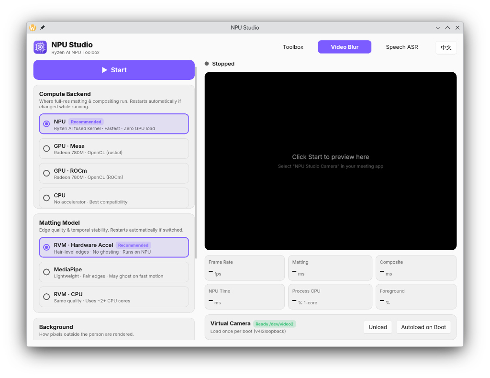
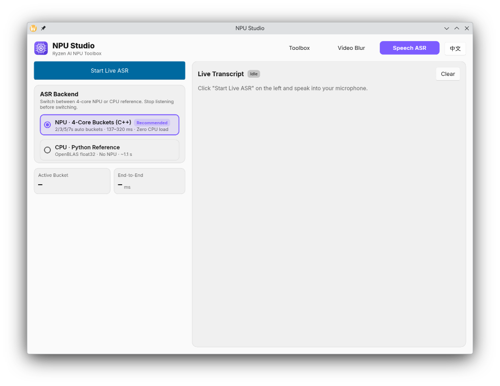

# NPU Studio — Ryzen AI (7840HS / XDNA1) Linux 桌面 NPU 实验工具箱

[English](README.md) | **简体中文**

> **实验项目声明**：这是一个用来探索 AMD 第一代桌面/移动 NPU 在 Linux 上究竟能做什么的实验性项目。目前实现的功能已经可以在日常中实际使用，但依然属于折腾与验证性质，不保证没有边界 bug 或硬件兼容问题。

---

## 项目背景：给早期 NPU 找点事做

**AMD Ryzen 7 7840HS**（Phoenix 架构）搭载了 AMD 第一代 **XDNA1 (AIE2)** NPU（算力约 10 TOPS）。随着 AMD 很快转向 Hawk Point 和 Strix Point（XDNA2），这代早期 Phoenix NPU 几乎没有获得多少主流软件生态的支持：在 Windows 上好歹还有基础的 *Windows Studio Effects*（背景虚化等）；而在 Linux 上，即便 `amdxdna` 驱动后来进了主线内核（约 6.14+），日常桌面软件也几乎不会去调用它——很多人戏称它是一块“电阻丝”，甚至直接在 BIOS 里关掉。

借助 AI 辅助编写 AIE2 算子内核与编译器调度（`mlir-aie` / IRON + XRT + `amdxdna`），这个项目想亲自验证一件事：**这块早期 NPU 在 Linux 上到底能不能跑出真正实用的实时任务，把 CPU 或 GPU 的负载 offload 掉？**

实测下来，答案是可以的。本项目基于自研的 AIE2 C++ 核内算子（`aie::mmul<4,8,8>`、非对称步长 DWConv、定点 LayerNorm、LUT GELU、Attention）和 Rust + Slint 桌面界面，目前跑通了三套可直接使用的实用工具。

---

## 已实现的功能模块

| 视频背景虚化与虚拟摄像头 | 实时语音转写 (ASR) |
|---|---|
|  |  |

### 1. 视频背景虚化与虚拟摄像头（`studio/` + `npu/rvm/`）
- 实时人像抠图（**RVM MobileNetV3 int8** 或 **MediaPipe**）+ 背景虚化 / 自定义背景图 / 绿幕。
- 通过 `v4l2loopback` 输出 `NPU Studio Camera` 虚拟摄像头，可用于 Zoom（实测 Flatpak 版 Zoom 可用，建议先在 NPU Studio 加载并开启推流再打开 Zoom）、OBS 和浏览器；界面支持一键 **加载 / 卸载 / 开机自动加载**。
- 可切换计算后端：**NPU**、**GPU（Radeon 780M · Mesa rusticl / ROCm OpenCL）** 或 **CPU**。

### 2. 40 层 Transformer 实时语音转写（`npu/asr/`）
- 完整 40 层量化 int8 Transformer 声学模型跑在 4 核 NPU 上（与 numpy 整数参考逐字节一致 `max_diff == 0`，测试样本 `CER 0%`）。
- 提供完全脱离 Python 的 **C++ XRT + OpenBLAS** 常驻后端（`npu/asr/asr_npu.cpp`）：
  - **冷启动**：`0.67–0.95 秒`
  - **2 / 3 / 5 / 7 秒四档自动分档**：
    - `W=10`（≤2 秒）：端到端 **`136.7 ms`**（`fb=0.7 / fe=4.1 / npu=130.2 / out=1.7 ms`）
    - `W=15`（≤3 秒）：端到端 **`159.5 ms`**
    - `W=25`（≤5 秒）：端到端 **`219.4 ms`**
    - `W=35`（≤7 秒）：端到端 **`320.0 ms`**
- 界面同时保留 **CPU 参考后端（OpenBLAS `float32`）** 供直接对比。

### 3. 屏幕框选 OCR（`npu/ocr/` + `app/src/ocr.rs`）
- 异构 **PP-OCRv4 Mobile** 中英文文本检测与识别：
  - **NPU（int8）**：49 层 MobileNetV3 检测主干（`480×640` 块约 `35 ms`）+ 50 层 PP-LCNet 识别主干（`max_diff == 0`，单行约 `20 ms`，支持 `s=(2,1)/(1,2)` 非对称步长 DWConv）。
  - **CPU（`onnxruntime`）**：负责 FPN + DBHead（约 `13 ms`）与 SVTR + 6625 类 CTC 头（每行约 `1–3 ms`）。
- **1:1 分块推理**：大图自动按 `480×640` 重叠滑窗检测，超宽文本行按空白列智能切分为 `48×320` 识别，避免 `1000+ px` 宽图被压扁失真。
- 桌面端集成屏幕框选截图（KDE Wayland 下调用 `spectacle -r`，兼容 `grim+slurp` / `gnome-screenshot`）、缩略图预览、可编辑文本输出与一键复制。

### 4. NPU Studio 桌面工具箱（`app/`）
- 基于 **Rust + Slint 1.18** 构建。
- 采用模块化 **Toolbox** 导航：*工具箱首页*、*背景虚化*、*实时语音转写*、*屏幕 OCR*。
- 支持 **中文 / English** 一键切换（配置保存在 `~/.config/npu-studio/settings.json`）。

---

## 实测环境与核心依赖版本

本仓库所有功能与性能数据均在以下环境实测通过：

| 组件 | 实测版本 | 说明 |
|---|---|---|
| **处理器 / NPU** | AMD Ryzen 7 7840HS (Phoenix) | 第一代 XDNA1 AIE2 NPU (~10 TOPS) + Radeon 780M |
| **Linux 内核** | `7.4.0-rc2-1-cachyos-rc` | 启用 `amdxdna` 内核驱动 |
| **XRT 运行时** | `1:2.21.75-14` | Xilinx Runtime（Arch/CachyOS 若仓库 `xrt` 超前，建议在 `pacman.conf` 加 `IgnorePkg = xrt` 与插件保持同版本） |
| **XRT XDNA 插件** | `1:2.21.75-2.1` | `xrt-plugin-amdxdna` |
| **MLIR-AIE (IRON)** | `1.3.4` | AIE2 编译与 Python 运行时 |
| **Python 环境** | `3.14.10` | `numpy 2.5.4`、`opencv-python-headless 5.0.0.93` |
| **BLAS 库** | `OpenBLAS` (`libopenblasp` / `cblas 3.12.1`) | C++ ASR 前端卷积与输出头必须链接 OpenBLAS |
| **虚拟摄像头驱动** | `v4l2loopback-dkms 0.15.4-2` | 需以 `exclusive_caps=1` 加载 |
| **桌面前端** | `rustc 1.99.1`, `slint 1.18` | `cargo build --release` |

---

## 构建与安装

### 1. 运行 NPU 内核回归测试
```bash
source npu/env.sh
.venv-iron/bin/python -m npu.check --quick   # 预期 20/20 通过 (max_diff == 0)
```

### 2. 导出并编译 C++ 四档语音识别后端
```bash
source npu/env.sh
.venv-iron/bin/python -m npu.asr.export_c_bundle   # 导出至 ~/.npu/asr/asr_4c_bundle

L=$PWD/.venv-iron/lib/python3.14/site-packages/opencv_python_headless.libs
g++ -O3 -std=c++17 -I/usr/include/xrt npu/asr/asr_npu.cpp -lxrt_coreutil \
    $L/libopenblasp-r0-59ffcd50.3.15.so -Wl,-rpath,$L -lm -o ~/.npu/asr/asr_npu_cpp
```

（可选）命令行直接测麦克风：
```bash
.venv-iron/bin/python -m npu.asr.shell_asr --cpp
```

### 3. 编译并安装 NPU Studio 桌面端
```bash
./app/install.sh
```
脚本会编译 release 版本（`app/target/release/npu-studio`）并安装桌面快捷方式到 `~/.local/share/applications/npu-studio.desktop`。

---

## 开发者与 Agent 说明

- NPU 内核开发规则与硬件限制：[`AGENTS.md`](AGENTS.md) / [`CLAUDE.md`](CLAUDE.md) / [`.claude/skills/npu-dev/SKILL.md`](.claude/skills/npu-dev/SKILL.md)
- 可复用 XDNA1 AIE2 C16 内核与算子链库说明：[`docs/kernel-library.md`](docs/kernel-library.md)
- ASR NPU 详细性能拆解与瓶颈记录：[`docs/asr-npu.md`](docs/asr-npu.md)

## 开源协议

本项目采用 **GNU GPL-3.0-or-later** 协议开源，详见 [`LICENSE`](LICENSE)。
